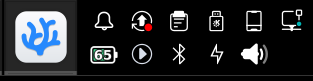
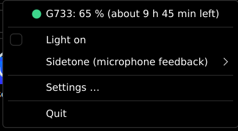
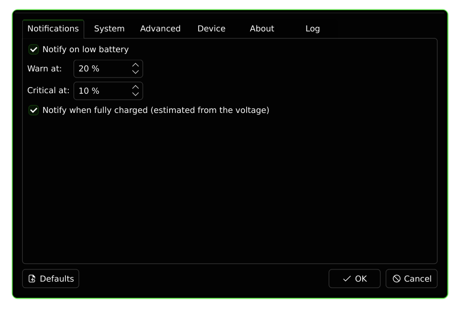

# g733-tray

🇩🇪 [Deutsche Version](README.de.md)

Battery level and light control for the Logitech G733 headset (USB dongle `046d:0ab5`) in the KDE Plasma 6 system tray. Built with PyQt6 on top of [headsetcontrol](https://github.com/Sapd/HeadsetControl) 4.2.0 or newer.

## Features

- **Battery in the tray icon:** percentage in the icon, orange/red when low, crossed out when the headset is off. The tooltip also shows the estimated remaining time.
- **Notifications:** low battery (warning and critical) and "fully charged".
- **Light and sidetone are remembered:** the headset forgets them when it powers off, so they are set again about 1.5 s after you switch it on.
- **Charging:** the headset's percentage is unreliable while charging (it jumps to ~100 % within seconds). The icon shows a bolt instead and the tooltip names the level before charging.
- **Menu:** status line (coloured dot, click to refresh), light on/off, sidetone, settings, quit.
- **12 languages**, settings changes apply immediately.

<p>
  
  
</p>
<p>
  
</p>

## Installation

1. Install [headsetcontrol](https://github.com/Sapd/HeadsetControl) 4.2.0 or newer (it must be in your `PATH`).
2. Download the package for your distribution from the [releases page](https://github.com/Spider19996/HeadsetControl-G733-Tray/releases) and install it:

   | Distribution | Installation |
   |---|---|
   | Debian, Ubuntu, PikaOS and derivatives | `sudo apt install ./g733-tray_<version>_all.deb` |
   | Fedora | `sudo dnf install ./g733-tray-<version>-1.fc*.noarch.rpm` |
   | openSUSE | `sudo zypper install ./g733-tray-<version>-1.*.noarch.rpm` |
   | Arch, Manjaro, EndeavourOS | `cd packaging/arch && makepkg -si` |
   | everything else | see *Other distributions* below |

3. Unplug the dongle and plug it in again once (so the udev rule takes effect), then start "G733 Tray" from the application menu.

To start it at login, enable *Settings → System → Start at login*.

The packages install everything else (PyQt6 from your distribution, the udev rule, the application menu entry). PyQt6 from pip is deliberately not used: it ships its own Qt, which only knows the Fusion style, so the settings dialog would not match your Plasma style.

### Other distributions

You need Python ≥ 3.9 with `venv` (developed and tested only with 3.14) and **PyQt6 as a system package** (`python3-pyqt6` on Debian and Fedora, `python-pyqt6` on Arch). Optional: `notify-send` (`libnotify`), so the critical notification gets higher urgency.

```sh
git clone https://github.com/Spider19996/HeadsetControl-G733-Tray.git
cd HeadsetControl-G733-Tray
./install.sh --udev --autostart
```

The script creates its own venv under `~/.local/share/g733-tray/venv`, links `~/.local/bin/g733-tray` and creates the application menu entry. Afterwards the folder may be deleted.

| Option | Effect |
|---|---|
| `--udev` | installs the udev rule to `/etc/udev/rules.d/` (asks via `sudo`) |
| `--autostart` | starts the program at login |
| `--no-launcher` | does not create an application menu entry |

Uninstall with `./uninstall.sh` (the configuration is kept, remove the udev rule manually).

The **udev rule** gives the logged-in user read access to the dongle, so no `sudo` is needed. On many systems the `70-headsets.rules` rule from headsetcontrol is already enough.

## Usage

Start `g733-tray` or "G733 Tray" in the application menu. A second instance exits immediately.

Light and sidetone are set directly in the tray menu. Everything else is under *Settings …*: notifications and thresholds, autostart, language, intervals, device selection, and the *Info* and *Log* tabs.

If something is wrong, the tray says so: "headsetcontrol not found" (install it), "Dongle not found" (plug it in) or "headsetcontrol error" (see the *Log* tab).

## Configuration

Most options are in the settings dialog. The file `~/.config/g733-tray/config.json` can also be edited by hand; changes are picked up automatically.

| Key | Default | Meaning |
|---|---|---|
| `language` | `auto` | `auto` (system language) or a language code (`de`, `en`, `es`, `fr`, `it`, `pt`, `nl`, `pl`, `ru`, `tr`, `zh`, `ja`) |
| `usb_vendor_id` / `usb_product_id` | `046d` / `0ab5` | USB IDs of the dongle (hex), see *Other headsets* |
| `light` | `true` | saved light state |
| `sidetone` | `null` | `null` = do not manage, otherwise 0-128 (menu: Off/Low/Medium/High) |
| `notifications` | `true` | low-battery notifications on/off |
| `warn_threshold` | `20` | warning at ≤ this percentage |
| `critical_threshold` | `10` | critical notification (high urgency) |
| `full_charge_notification` | `true` | "fully charged" notification |
| `poll_interval_s` | `60` | how often the level is checked (min. 5) |
| `relight_delay_ms` | `1500` | wait after power-on before the light is set |

Each threshold fires once per discharge and re-arms when the headset charges or the level rises above it again. If the level is already below both thresholds, only the critical notification appears.

**Fully charged** is an estimate from the voltage, because the percentage is useless while charging: if the voltage rises by at most 5 mV over 10 minutes and is above 4100 mV, the notification appears once per charge. These limits are rules of thumb and not yet validated over a complete charge.

Notifications go through `notify-send` to the Plasma notification service (the only way to set the urgency). Without it, `QSystemTrayIcon.showMessage` is used.

## Other headsets

The default is the Logitech G733. Under *Settings → Device* you choose your headset from a list of all devices headsetcontrol detects (dongle plugged in; the headset may be off). *Search again* refreshes the list, *Reset to G733* restores the default.

If your device does not show up, choose *Enter other IDs manually …* and enter the vendor and product ID. You find them with `lsusb`, e.g. `ID 046d:0ab5 Logitech, Inc. G733 Gaming Headset` (vendor ID before, product ID after the colon).

The headset must be supported by headsetcontrol, and your user needs read access to the dongle (udev rule; headsetcontrol ships one for supported devices). Instant power-on detection is only verified for the G733; for other models the check every 60 s applies.

## Log file

The log is written to `~/.local/state/g733-tray/g733-tray.log` (or `$XDG_STATE_HOME`). It is **cleared at every program start** and capped at about 1 MB. The *Log* tab in the settings shows it directly (with *Copy all* and *Open log file*). For bug reports, the *Copy* button in the *Info* tab and the log are usually enough.

```sh
g733-tray --verbose    # DEBUG messages in the terminal and the log file
```

---

# For developers

## How it works

Power-on is detected event-driven by reading the dongle's hidraw node (`11 ff 08 …`: bytes 4-5 = battery voltage, 0 = off). In addition, `headsetcontrol -b -o json` reconciles level and state every 60 s.

## Running from the source tree

```sh
python3 -m venv --system-site-packages .venv && .venv/bin/pip install -e .
.venv/bin/python -m unittest discover -s tests -t .
```

## Test mode

Replaces the headset and the HID watcher with a fake battery level. The configuration is not written, a running normal instance does not interfere, and the log goes to `g733-tray-test.log`.

```sh
g733-tray --fake-battery 15                 # tooltip/icon/warning
g733-tray --fake-battery off                # "powered off"
g733-tray --fake-battery 80 --fake-charging
g733-tray --fake-battery 25 --simulate-drain --drain-interval 1   # drops 1 % per second
```

## Translations

Each language is a file `g733_tray/lang/<code>.py` containing a dictionary (key = German source text). The translations were produced by an AI and have not been reviewed by native speakers; corrections are welcome.

To add a language: copy a file and translate it, then add the code to `LANGUAGES` in `g733_tray/i18n.py`. New texts in the code are written as `tr("German text")`. The test `tests/test_i18n.py` checks for every language that all texts are present and that placeholders (e.g. `{level}`) match.

The log file and the output of `--help` are always English so bug reports are readable for everyone.

## Building packages and releases

```sh
./packaging/build-deb.sh   # needs only dpkg-deb, result: dist/g733-tray_<version>_all.deb
./packaging/build-rpm.sh   # needs rpmbuild, result: dist/*.rpm
```

The version lives only in `g733_tray/__init__.py` (`__version__`) and is read by pyproject, the build scripts and the *Info* tab. Pushing a Git tag `vX.Y.Z` makes the GitHub Action [release.yml](.github/workflows/release.yml) build both packages and attach them to a release. Before tagging, bump the version there, in `packaging/g733-tray.spec` and as `pkgver` in the PKGBUILD.

The Arch package and the release Action have not been tested yet. The RPM builds and installs on Fedora (checked in a container).

## License

MIT, see [LICENSE](LICENSE).
